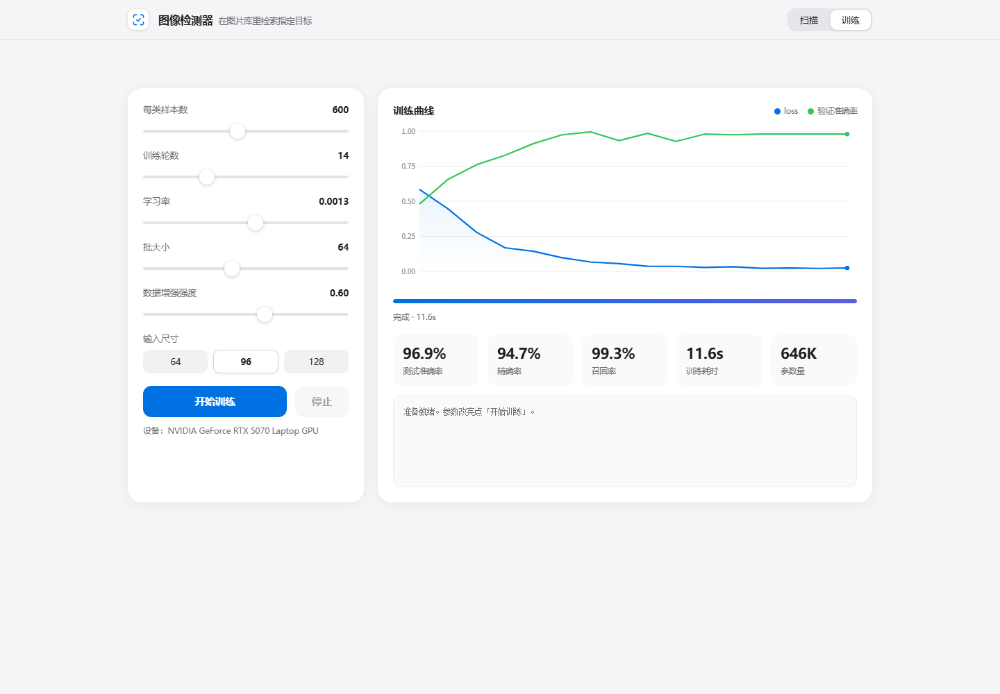
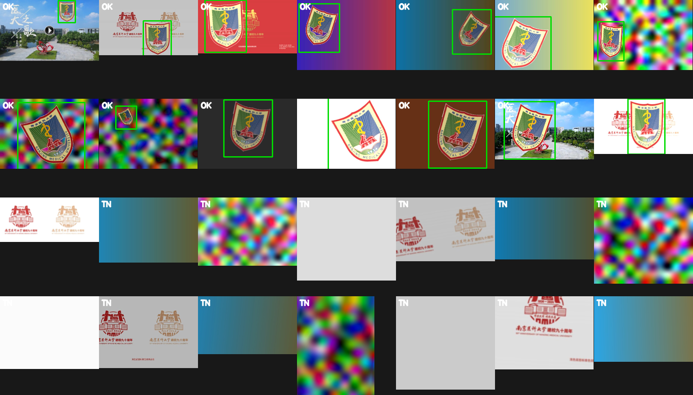

# logo-hunter

> 给一个装满各种图片的文件夹，**自动挑出里面含指定标识的那几张**，
> 并在图上把它的位置框出来。自带**可视化训练页**（拖滑块调参、实时看曲线），
> 也能换成你自己的 logo / 徽章 / 特定图案。

[](https://github.com/ikunchumo/logo-hunter)
[](LICENSE)


**仓库地址：https://github.com/ikunchumo/logo-hunter**


## 两个页面

**扫描页** —— 填一个文件夹路径，点扫描。命中的图排在最前面、绿框圈出目标位置，
没命中的排在后面。

**训练页** —— 拖滑块调参，点开始就能看到实时训练曲线：



| 可调参数 | 范围 |
|---|---|
| 每类样本数 | 100 ~ 1200 |
| 训练轮数 | 3 ~ 40 |
| 学习率 | 1e-4 ~ 1e-2（对数滑块） |
| 批大小 | 16 ~ 128 |
| 数据增强强度 | 0 ~ 1（旋转/颜色/随机擦除） |
| 输入尺寸 | 64 / 96 / 128 |

面板右边实时画 loss 与验证准确率，训练结束给出测试准确率、精确率、召回率、
耗时、参数量。默认参数（每类 600 / 14 轮）在 RTX 5070 上约 **13 秒**跑完，
准确率 **96.5%**。

## 两种方法，各管一段

| | SIFT 特征匹配 | CNN 二分类 |
|---|---|---|
| 要不要训练 | 不用，一张模板就够 | 要，但网页上点一下就行 |
| 输出 | **框出目标位置** | 只回答「有没有」 |
| 换 logo | 换一张模板图 | 要重新训练 |
| 速度 | 约 300~600 ms/张 | 约 3 ms/张（GPU） |
| 适合 | 精确定位、少量图片 | 大批量粗筛 |

实际用起来是**先 CNN 粗筛、再 SIFT 定位**：CNN 把没目标的图快速甩掉，
剩下的交给 SIFT 画框。

## 效果

| 测试集 | 结果 |
|---|---|
| 合成测试集（40 正 + 30 负，旋转/透视/缩放 12%~55%/模糊/JPEG 压缩） | 召回 **100%**，精确率 **100%** |
| 真实官网素材（目标标准图 / 相似干扰项 / 校园风景 / 网页小 logo） | 5/5 判断正确 |
| 训练页默认参数（每类 600，14 轮） | 测试准确率 **96.5%**，召回 99.3%，精确率 94.1% |

负样本里故意放了最容易混淆的东西：**90 周年校庆标识**（同样的红色调、同样的校名文字）、
校园风景、纯色与纹理背景 —— 全部没有误检。



## 怎么做的

目标本身是**固定图案**：不管怎么旋转、缩放、透视、光照变化，它的局部纹理
（盾形轮廓、蛇杖、麦穗、1934、英文字）都不变。所以用 SIFT 特征匹配就够了：

```
模板 SIFT 特征（2072 个关键点）
        ↓
待检图多尺度 SIFT（1.0x / 1.7x / 2.6x，兼顾远拍小目标与近拍大目标）
        ↓
FLANN KNN 匹配 + Lowe ratio 0.72 筛选
        ↓
RANSAC 单应性估计，把模板四角投影到图里
        ↓
几何校验：内点 ≥12、内点比例 ≥0.26、投影框长宽比 0.45~1.45
        ↓
输出：是否命中 + 外框 + 置信度
```

另外训练一个 CNN 做二分类（含目标 / 不含），数据是从真实图合成的 2400 张
「贴了目标的局部块」+「随机块（30% 带模糊小目标干扰）」。

几个工程细节：

- **扫描是纯 CPU 的，而且故意如此**：SIFT 在 OpenCV 里没有 CUDA 实现（`cv2.cuda.SIFT` 不存在，
  CUDA 模块只有 FAST/ORB/BFMatcher 这一档），本机这个 opencv-python 包 `cv2.cuda.getCudaEnabledDeviceCount()`
  还是 0。真正的问题是 SIFT 单线程只用 1 个核，所以改成**多进程**：

  | 进程数 | 118 张耗时 | 单张 | 命中 |
  |---|---|---|---|
  | 1 | 118.0 s | 1000 ms | 14 |
  | 8 | 39.3 s | 333 ms | 14 |

  3 倍加速，结果完全一致。
- **`nfeatures` 要设 0（不限）**：设成 3000 时，SIFT 会按响应值截断关键点，
  在并列响应值上取舍不稳定，同一张图在主进程和子进程里内点数能差 5~10 个，
  边缘样本（内点 12 附近）的判定会翻转。改成不限之后，1 进程和 8 进程的命中数完全对齐。
- **级联早停**：原尺度上已经很确定就不再试放大尺度。
- **框的收紧**：单应性投影的框经常把背景圈进来，用「内点在图上的外接框」兜底，只在投影框明显偏大时才替换。
- **阈值来自网格搜索**：`src/sweep.py` 扫了 27 组参数，`ratio=0.72 / 内点≥12 / 内点比例≥0.26` 是召回与误检的平衡点。
- **模板质量**：从标准图上裁出目标后放大 2.2 倍并锐化（原图是 JPEG，边缘太软，SIFT 点会少一半）。
- **JPEG 质量很关键**：示例图按 quality 88 存时，7 张含目标的图有 4 张掉到内点阈值以下；
  换成 quality 97 后全部检出。存中间结果时别过度压缩。

### 为什么不用 GPU 加速扫描？

试过三条路，只有多进程是值得的：

| 方案 | 结果 |
|---|---|
| 装 CUDA 版 OpenCV | CUDA 模块里根本没有 SIFT；换 ORB 又掉了旋转/尺度鲁棒性 |
| 用训练好的 CNN 先粗筛 | 整图缩到 96px 后目标太小，含目标的 7 张只认出 4 张（召回 57%），会漏一半 |
| 多进程并行 SIFT | **可用**：8 进程 3 倍加速，结果一致 |

CNN 那条路的失败很典型：它在「紧贴目标的局部块」上训练，正样本里目标占画面 30~60%，
而真实图片里目标往往只占 5%。要让它派上用场，得改成**滑窗推理**
（把图切成 96×96 的块、批量送 GPU），那是另一个量级的工程。

结论：**这个任务的计算瓶颈是特征匹配的纯 CPU 运算，不是 GPU 算力**。

## 用法

### 网页版（推荐）

```bash
python src/app.py            # 打开 http://127.0.0.1:8770
```

- `?view=train` 直接进训练页
- `?dir=D:\photos` 打开就自动扫这个文件夹

### 命令行（推荐批量）

```bash
python src/scan.py D:\photos
python src/scan.py D:\photos --crop          # 顺便把目标裁出来
python src/scan.py D:\photos --out D:\out
```

产物：

```
results/hits.csv         命中清单（文件、置信度、内点数、耗时、框）
results/hits.json        同上，JSON
results/annotated/*.jpg  命中的图，画了绿框
results/crops/*.png      --crop 时裁出的目标
```

### 代码里调用

```python
import sys; sys.path.insert(0, "src")
from detector import BadgeDetector

d = BadgeDetector()
hit = d.detect_file("some_photo.jpg")
print(hit.found, hit.score, hit.box)     # True 218.0 (266, 278, 155, 200)
```

### 换成别的目标 / logo

只需替换模板，**代码不用改**：

```python
# 1) 准备一张干净的 logo 图（白底、正视角最好，长边 300~600 px）
# 2) 存成 assets/template.png
# 3) 直接跑
python src/scan.py D:\photos
```

命令行也支持临时指定：

```python
from detector import BadgeDetector
d = BadgeDetector("D:/my_logos/company_logo.png")
```

## 目录结构

```
logo-hunter/
├─ assets/
│  ├─ template.png          检测模板（目标，337×436）
│  ├─ template_mask.png     带 alpha 的版本（合成训练数据用）
│  └─ candidate_*.jpg        官网抓的原始素材
├─ data/
│  ├─ samples/
│  │  ├─ raw/                官网抓的 58 张原图
│  │  ├─ with_badge/         其中 8 张含目标
│  │  ├─ without_badge/      50 张不含目标
│  │  └─ labels.csv          自动分类结果（内点数 / 框 / 耗时）
│  ├─ testset/               70 张合成测试图 + gt.json
│  └─ train_pool.npz         2400 张二分类训练池（96×96）
├─ src/
│  ├─ crawl_samples.py       从官网抓真实图片
│  ├─ classify_samples.py    用检测器自动分成含/不含目标
│  ├─ extract_template.py    从官方标准图裁出检测模板
│  ├─ detector.py            SIFT + 单应性检测器（核心）
│  ├─ make_testset.py        造评测集（贴图 + 变换 + 负样本）
│  ├─ evaluate.py            算召回/精确率，画检测网格
│  ├─ sweep.py               参数网格搜索
│  ├─ build_train_pool.py    合成二分类训练池
│  ├─ trainer.py             CNN 训练器（供网页调参）
│  ├─ scan.py                批量扫描文件夹（CLI）
│  └─ app.py                 网页版（扫描 + 训练，苹果风）
├─ models/badge_cnn.pt       训练页产出的 CNN
├─ results/                  扫描产物
└─ docs/                     可视化图
```

## 复现

```bash
pip install -r requirements.txt

python src/crawl_samples.py        # 抓真实图（可选，仓库里已带）
python src/classify_samples.py     # 自动分含/不含目标
python src/extract_template.py     # 裁模板
python src/make_testset.py         # 造测试集
python src/evaluate.py             # 基线评估
python src/sweep.py                # 调参（可选）
python src/build_train_pool.py     # 造训练池
python src/scan.py data\testset    # 批量扫描
python src/app.py                  # 网页版（扫描 + 训练）
```

环境：Python 3.11 + `opencv-python` 4.11 + `torch` 2.7（CUDA 可选）。

> 仓库里不含大文件（`data/train_pool.npz`、`data/samples/raw/`、`data/testset/`、
> `models/*.pt` 都被 `.gitignore` 排除），跑一遍上面的脚本就能全部再生成。

## 开源协议

MIT License — 见 [LICENSE](LICENSE)。

代码、脚本、文档可自由使用、修改、商用，保留版权声明即可。

## 致谢

- [OpenCV](https://opencv.org/) — SIFT / FLANN / RANSAC 实现
- [PyTorch](https://pytorch.org/) — CNN 训练
- [python-pptx](https://python-pptx.readthedocs.io/) — 汇报 PPT 生成

---

如果这个项目对你有用，欢迎 Star ⭐
[github.com/ikunchumo/logo-hunter](https://github.com/ikunchumo/logo-hunter)

